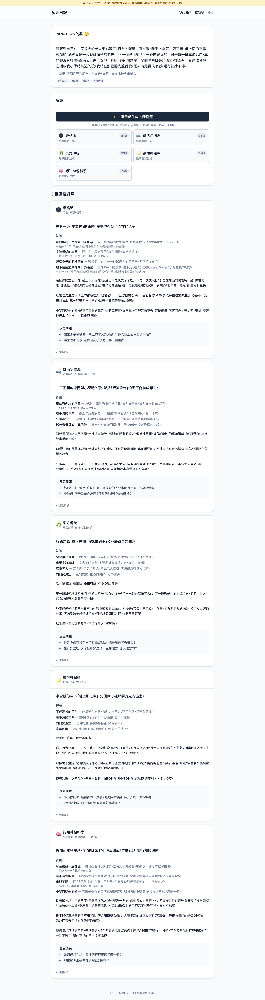
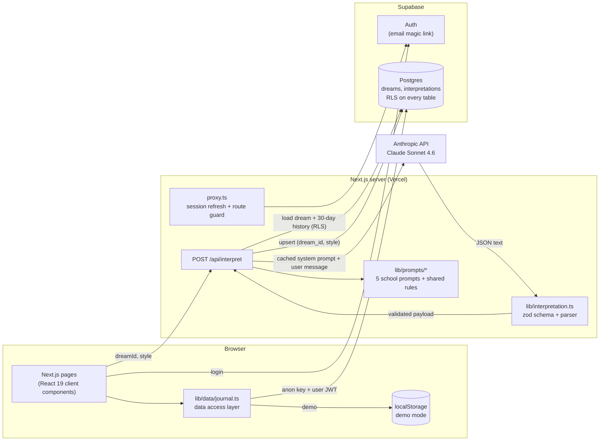

# Dream Journal (解夢日記)

**One dream, five readings.** A Traditional Chinese dream journal where Claude interprets each entry through five distinct schools of thought (Jungian, Freudian, Eastern folk tradition, spiritual, and cognitive neuroscience) and lays them side by side.

Built solo with Next.js 16, React 19, TypeScript, Supabase (Postgres, Auth, row-level security) and the Anthropic SDK. [中文說明](README_zh-TW.md)



---

## The problem

Dream apps for Chinese-speaking users are mostly "周公解夢" lookup tables: you search for "snake" and get "a petty person is plotting against you". There is no journal, no memory of your earlier dreams, and only one way of looking at things.

People who keep a dream journal want two things those tools miss:

1. **Context.** A dream about missing a train means something different if stations have shown up three times this month and you spent the week comparing train timetables for a trip.
2. **Perspective.** A Jungian reading and a neuroscience reading of the same dream are both useful, and they are more useful next to each other.

Dream Journal stores your entries, pulls your recent history into each reading, and lets you compare five schools on the same dream with one click.

## Features

- **Journal entries**: dream text, mood, optional waking-life context, tags and date.
- **Five interpretation schools**, each with its own system prompt, vocabulary, tone and school-specific output fields:

  | School | Focus | School-specific fields |
  |---|---|---|
  | 🌑 Jungian | shadow, archetypes, individuation | `archetypes_detected`, `compensation_hypothesis` |
  | 🛋 Freudian | latent content, dream-work, childhood | `dreamwork_observed`, `latent_hypothesis`, `childhood_link` |
  | 🐉 Eastern tradition | Zhou Gong symbols, five elements | `zhougong_matches`, `five_elements`, `practical_advice` |
  | 🌙 Spiritual | tarot, elements, soul themes | `tarot_resonance`, `soul_theme`, `gentle_ritual` |
  | 🧠 Cognitive neuroscience | memory consolidation, emotion processing, day residue | `likely_day_residue`, `sleep_health_note`, `red_flags` |

- **Compare all five in one click.** Styles run one after another; each card appears as soon as it is ready, and a failure in one school does not discard the others.
- **Personal history in every reading.** The last 30 days of entries (up to 10, each clipped to 120 characters) go into the prompt, so readings can point out recurring symbols and moods.
- **Safety guardrails.** Prompts forbid diagnosis, fortune-telling and fatalistic wording. When the cognitive reading flags risk signals (self-harm themes, long-term insomnia, severe hopelessness), the card shows Taiwan's 1925 and 1980 support hotlines.
- **Passwordless login** with Supabase email magic links.
- **Demo mode.** The whole app runs in the browser with a sample dream and pre-written readings, so you can try it without a Supabase project or an API key.

## Screenshots

All screenshots are from demo mode (`NEXT_PUBLIC_DEMO_MODE=true`), captured with headless Chromium.

| Landing | Journal |
|---|---|
|  |  |

| New entry | Jungian reading |
|---|---|
|  |  |

The cognitive-neuroscience reading of the same dream:


## Architecture



**Request flow for one interpretation**

1. The client posts `{ dreamId, style }` to `/api/interpret`. The body is validated with zod.
2. The route reads the user from the Supabase session cookie and loads the dream plus up to 10 entries from the last 30 days. RLS limits both queries to the signed-in user, and the route also checks `dream.user_id` before calling the model.
3. `interpretDream()` sends the school's system prompt (marked with `cache_control`) and a user message with the dream, context and history wrapped in `<dream>`, `<user_context>` and `<history>` tags.
4. The reply is parsed and validated by `parseInterpretation()`, then upserted on `(dream_id, style)`, so regenerating a school replaces the old reading.
5. Token usage, including cache reads and writes, is logged. Dream text is never logged.

## Key engineering decisions

### 1. Prompt design: five schools that stay in their lane

Each school lives in its own file under `web/lib/prompts/` and follows the same structure:

- **Thinking tools** the school actually uses (for Jungian: archetypes, shadow, compensation, amplification).
- **What not to do**, written to keep the schools apart. The Jungian prompt says not to reduce everything to sexuality ("that is the Freudian school's job"); the cognitive prompt rules out archetypes and souls; the Eastern prompt avoids Western archetypes.
- **Tone**, with example phrasing.
- **Required `extra_fields`** for that school.
- **Shared rules** appended to every prompt: write in Traditional Chinese, separate what happened in the dream from the interpretation, prefer "this may reflect…" over "you will…", no medical diagnosis, end with one or two reflection questions, and one JSON output contract.

The prompts were tuned against a fictional reference dream (`samples/dream_01.md`: an old train station, a ticket you cannot read, a greenhouse full of sunflowers) with a hand-written five-school reference answer (`samples/dream_01_interpretations.md`). The review checklist: the five readings must be clearly different, must not repeat each other, must use the dreamer's own context, and must not stall on "not enough information".

**Trade-off:** one call per school instead of one call that returns all five. Separate calls cost more input tokens, but they keep the schools from bleeding into each other, let each card render as soon as it is ready, and mean one bad reply only costs one school.

### 2. Prompt caching and cost

The system prompt is the only part that is the same across users, so it is the cache prefix. Everything user-specific (dream, context, history) goes in the user message after the cache breakpoint. A test checks that no school prompt contains per-request data such as input tags or dates, because one changed byte in the prefix would invalidate the cache.

Each system prompt is about 3,000 characters of mostly Chinese text, which should clear Sonnet 4.6's 1,024-token minimum for caching. Cache reads are billed at a tenth of the normal input price. The route logs `cacheReadTokens` and `cacheWriteTokens` for every call, so the hit rate can be checked in production logs instead of assumed.

The planning estimate in the PRD is about US$0.017 per reading before caching (around 1,500 input and 800 output tokens on Sonnet 4.6), which keeps a free tier affordable for a solo project.

**Trade-off:** five schools means five separate cache entries. Caching pays off when many users request the same school within the cache lifetime; one user's "compare all five" touches five different prefixes.

### 3. Structured output, validated with zod

The model is asked for bare JSON in a fixed shape. `web/lib/interpretation.ts` turns the reply into typed data:

- `extractJsonText()` accepts bare JSON, a fenced code block, or JSON wrapped in a sentence.
- `InterpretationPayloadSchema` (zod) is strict where the UI depends on a field (`headline`, `body`, at least one reflection question) and fills safe defaults where a missing field is harmless (`symbols`, `extra_fields`, `personal_link`).
- A reply written for the wrong school is rejected.
- A `max_tokens` stop is reported as a clear error instead of being parsed as broken JSON.
- Error messages never include the raw reply, because it contains the user's dream.

The same schema validates the demo fixtures in the test suite, so demo data cannot drift from what production accepts.

### 4. Supabase row-level security

Row-level security is on for both tables, and the browser only ever holds the anon key plus the user's session. The app does not use the service-role key.

- `dreams`: select, insert, update and delete are limited to `auth.uid() = user_id`.
- `interpretations` has no `user_id` column; its policies check ownership through an `exists (select 1 from dreams …)` subquery.
- Migrations are append-only. `003_fix_rls.sql` adds the missing `UPDATE` policy on `interpretations`: without it, regenerating a school ran an upsert that RLS quietly blocked. The fix ships as a new migration instead of an edit to `002`.
- The API route checks ownership again in code before spending tokens.

### 5. Demo mode behind one data layer

`web/lib/data/journal.ts` exposes `getCurrentUser`, `listDreams`, `getDream`, `listInterpretations` and `createDream`. Each function reads either Supabase or localStorage, depending on `NEXT_PUBLIC_DEMO_MODE`. Pages do not know which backend they are on, so a reviewer can try the full UI with `npm run dev` and no accounts.

## Run it locally

Requires Node.js 20 or newer.

```bash
git clone <this repo>
cd <repo>/web
npm install
cp .env.example .env.local   # demo mode is on by default
npm run dev                  # http://localhost:3000
```

In demo mode, click **直接進入** on the login page, then **載入範例夢境** to load the sample dream, open it and press **一鍵生成 5 種對照**.

### Full mode (Supabase + Claude)

1. Create a Supabase project. In **SQL Editor**, run the files in `supabase/migrations/` in order: `001_init.sql`, `002_rls.sql`, `003_fix_rls.sql`.
2. In `web/.env.local`, set `NEXT_PUBLIC_DEMO_MODE=false` and fill in `NEXT_PUBLIC_SUPABASE_URL`, `NEXT_PUBLIC_SUPABASE_ANON_KEY` and `ANTHROPIC_API_KEY`.
3. In Supabase **Authentication → URL Configuration**, add `http://localhost:3000/auth/callback` as a redirect URL.
4. Run `npm run dev` and log in with your email.

Deployment to Vercel is covered step by step in [docs/DEPLOY.md](docs/DEPLOY.md).

### Checks

```bash
npm test            # vitest: parser, schema, history builder, prompt contracts
npm run lint
npm run typecheck
npm run build
```

## Project layout

```
supabase/migrations/     SQL schema and RLS policies (append-only)
web/
  app/                   App Router pages, /api/interpret, /auth/callback
  components/            hand-written UI components
  lib/prompts/           five school prompts + shared rules and output contract
  lib/interpretation.ts  zod schema, JSON extraction, history builder
  lib/anthropic.ts       Claude call with prompt caching and usage tracking
  lib/data/journal.ts    data access: Supabase or demo localStorage
  lib/demo/              demo fixtures and storage
  lib/supabase/          browser, server and proxy Supabase clients
  proxy.ts               session refresh and route protection
  tests/                 vitest suites
samples/                 reference dream and five-school reference answer
docs/                    PRD, setup and deployment guides, screenshots
```

`AGENTS.md` holds the rules used with AI coding assistants on this repo: stack constraints, product red lines and the prompt-change workflow.

## Roadmap

- **API-native structured outputs**: move the JSON contract into the request's output schema, keeping the zod check as a second layer.
- **Streaming readings** so long interpretations start rendering right away.
- **Insights**: recurring-symbol counts, mood trends, and a monthly review that uses Claude Haiku for cheap symbol extraction.
- **Search, export and account deletion**, following the privacy commitments in the PRD.
- **Per-user daily limit** on interpretations to keep a free tier sustainable.
- **RLS tests in CI** with the Supabase CLI, covering "owner can read, update and delete; other users cannot" for every policy.
- **PWA** for writing dreams on the phone right after waking up.

## License

© 2026 Hao-Fu Chang. All rights reserved.
