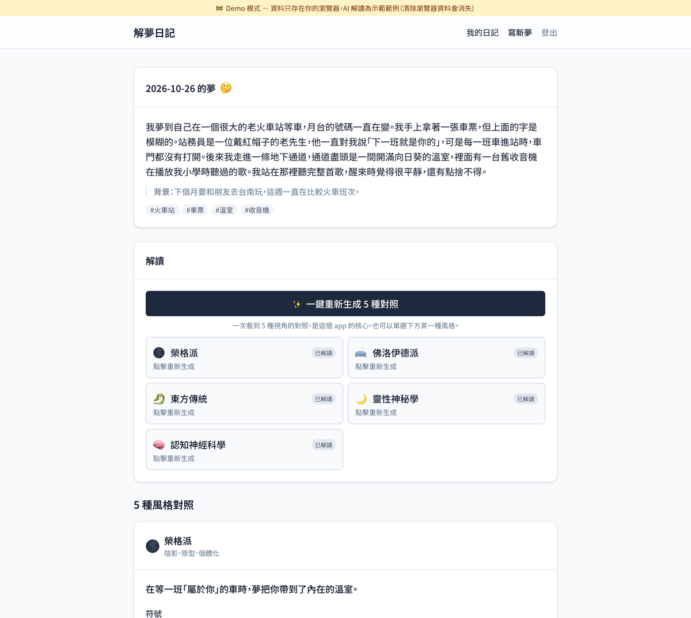
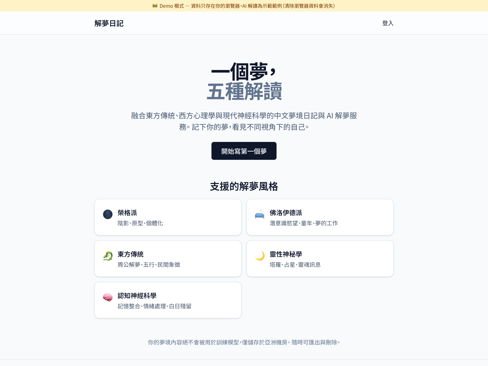
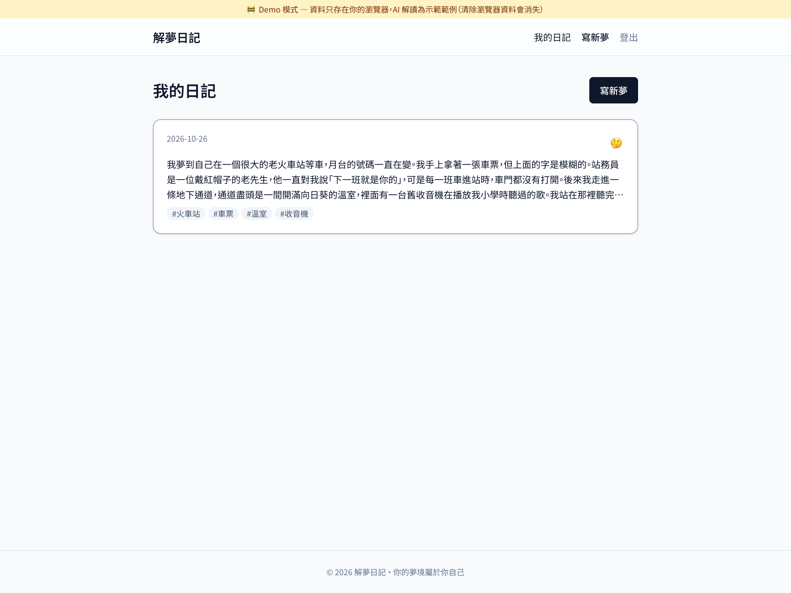
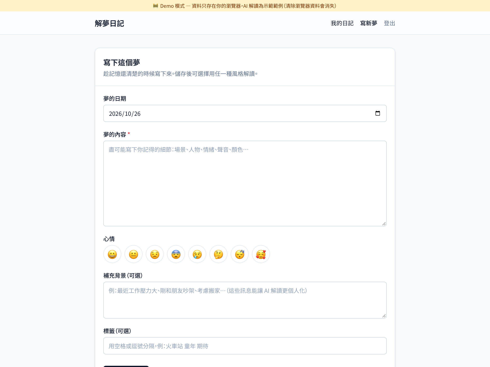
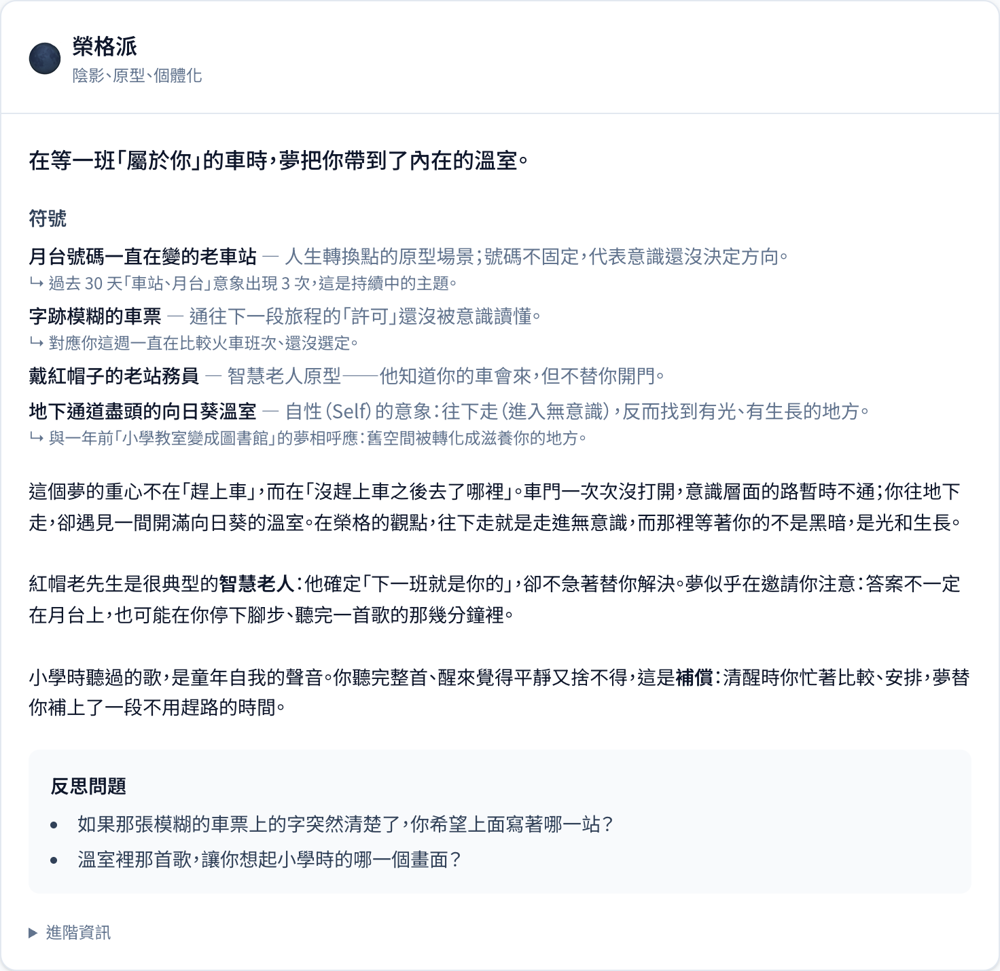
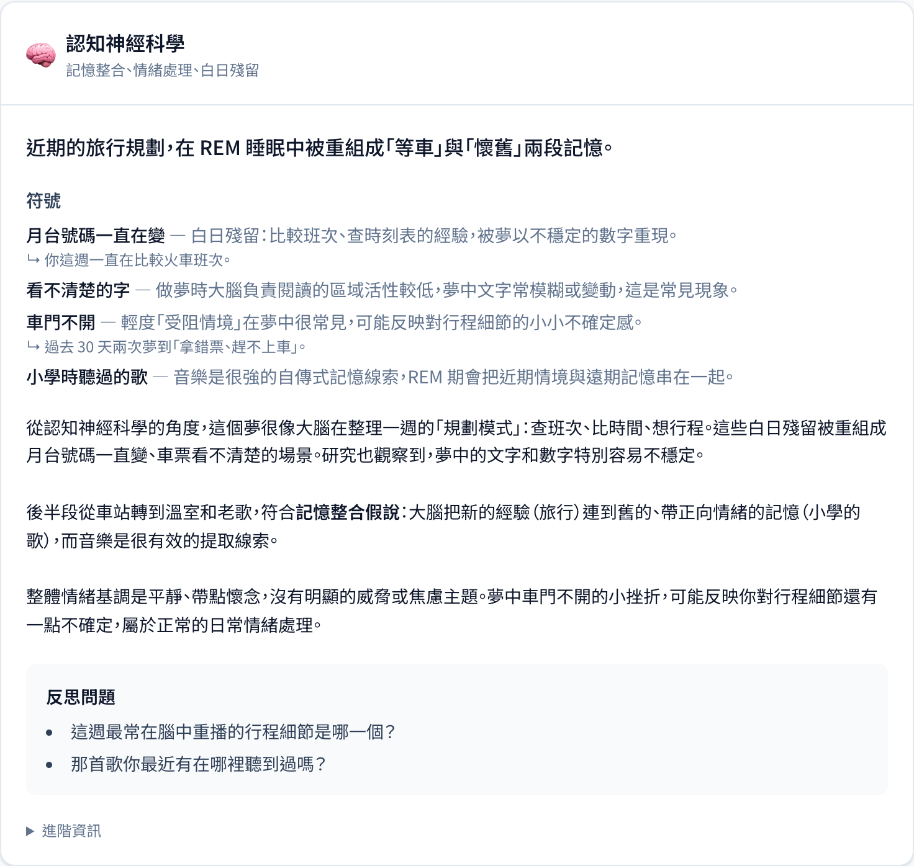
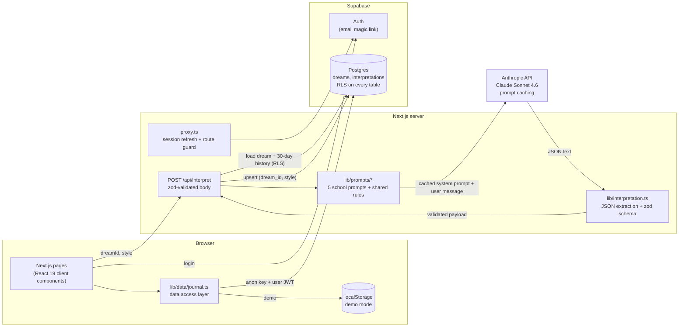

<div align="center">

# Dream Journal (解夢日記)

**One dream, five readings.** A Traditional Chinese dream journal where Claude interprets each entry through five schools of thought and lays them side by side.

[](https://nextjs.org/)
[](https://react.dev/)
[](https://www.typescriptlang.org/)
[](https://supabase.com/)
[](https://www.anthropic.com/)
[](https://tailwindcss.com/)
[](https://zod.dev/)
[](https://vitest.dev/)

[中文說明](README_zh-TW.md)



</div>

---

## What it does

- **Keeps a dream journal**: dream text, mood, optional waking-life context, tags and date, behind passwordless email login.
- **Interprets one dream five ways**: Jungian, Freudian, Eastern folk tradition (周公解夢), spiritual, and cognitive neuroscience. Each school has its own system prompt and its own structured output fields.
- **Compares all five in one click**: schools run one after another, each card appears as soon as it is ready, and a failure in one school does not discard the others.
- **Remembers your history**: up to 10 entries from the last 30 days go into each reading, so it can point out recurring symbols and moods.
- **Stays safe by design**: prompts forbid diagnosis, fortune-telling and fatalistic wording; when the cognitive reading flags risk signals, the card shows Taiwan's 1925 and 1980 support hotlines.

Built solo in May 2026; the first working MVP took about a day.

## Demo

Recorded in demo mode (`NEXT_PUBLIC_DEMO_MODE=true`) with headless Chromium: log in, load the sample dream, generate all five readings, scroll through the results. Demo mode uses pre-written readings, so no API key is involved.

<p align="center">
  
</p>

## Screenshots

All screenshots are from demo mode.

<table>
  <tr>
    <td width="50%"></td>
    <td width="50%"></td>
  </tr>
  <tr>
    <td align="center"><sub><b>Landing page</b></sub></td>
    <td align="center"><sub><b>Journal list</b></sub></td>
  </tr>
  <tr>
    <td></td>
    <td></td>
  </tr>
  <tr>
    <td align="center"><sub><b>New entry</b>: dream, mood, context, tags</sub></td>
    <td align="center"><sub><b>Jungian reading</b>: symbols, archetypes, reflection questions</sub></td>
  </tr>
  <tr>
    <td></td>
    <td><a href="docs/screenshots/04-five-schools.png"></a></td>
  </tr>
  <tr>
    <td align="center"><sub><b>Cognitive neuroscience reading</b> of the same dream</sub></td>
    <td align="center"><sub><b>Five-school comparison</b> (click for the full page)</sub></td>
  </tr>
</table>

## The five schools

| School | Focus | School-specific output fields |
|---|---|---|
| Jungian | shadow, archetypes, individuation | `archetypes_detected`, `compensation_hypothesis` |
| Freudian | latent content, dream-work, childhood | `dreamwork_observed`, `latent_hypothesis`, `childhood_link` |
| Eastern tradition | Zhou Gong symbols, five elements | `zhougong_matches`, `five_elements`, `practical_advice` |
| Spiritual | tarot, elements, soul themes | `tarot_resonance`, `soul_theme`, `gentle_ritual` |
| Cognitive neuroscience | memory consolidation, emotion processing, day residue | `likely_day_residue`, `sleep_health_note`, `red_flags` |

## Why this exists

Dream apps for Chinese-speaking users are mostly "周公解夢" lookup tables: search for "snake" and get "a petty person is plotting against you". There is no journal, no memory of earlier dreams, and only one way of looking at things. People who keep a dream journal want **context** (a dream about missing a train means something different if you spent the week comparing train timetables) and **perspective** (a Jungian reading and a neuroscience reading are more useful next to each other). Product details are in [docs/PRD.md](docs/PRD.md).

## Architecture



**Request flow for one interpretation**

1. The client posts `{ dreamId, style }` to `/api/interpret`. The body is validated with zod.
2. The route reads the user from the Supabase session cookie and loads the dream plus up to 10 entries from the last 30 days. RLS limits both queries to the signed-in user, and the route also checks `dream.user_id` before calling the model.
3. `interpretDream()` sends the school's system prompt (marked with `cache_control`) and a user message with the dream, context and history wrapped in `<dream>`, `<user_context>` and `<history>` tags.
4. The reply is parsed and validated by `parseInterpretation()`, then upserted on `(dream_id, style)`, so regenerating a school replaces the old reading.
5. Token usage, including cache reads and writes, is logged. Dream text is never logged.

## Key engineering decisions

| Decision | Why |
|---|---|
| **One prompt file per school, with a "what not to do" list** | Without explicit boundaries the schools drift toward the same generic reading. Each prompt names the thinking tools it may use and the ones that belong to other schools (the Jungian prompt leaves sexuality to the Freudian one; the cognitive prompt rules out archetypes and souls). |
| **One API call per school, not one call for all five** | Separate calls cost more input tokens, but they keep the schools from bleeding into each other, let each card render as soon as it is ready, and mean one bad reply only costs one school. |
| **Only the system prompt is cached** | The system prompt is the only part shared across users, so it is the cache prefix and everything personal goes after the breakpoint. A test fails if any school prompt contains per-request data, because one changed byte would invalidate the cache. |
| **zod validation of model output** | The UI needs typed data, and model output is not guaranteed to be clean JSON. The parser accepts bare JSON, fenced blocks or JSON inside a sentence, rejects replies for the wrong school, reports `max_tokens` cut-offs clearly, and never echoes the raw reply because it contains the user's dream. |
| **Row-level security on every table** | The browser only holds the anon key and the user's session, so the database itself has to enforce ownership. The app never uses the service-role key, and the API route checks ownership again before spending tokens. |
| **Demo mode behind one data layer** | Reviewers should be able to try the whole product with `npm run dev` and no accounts. Pages call one data layer that switches between Supabase and localStorage, so demo mode exercises the same UI code as production. |

The sections below give the details.

### 1. Prompt design: five schools that stay in their lane

Each school lives in its own file under `web/lib/prompts/` with the same structure: the **thinking tools** the school uses, a **what not to do** list that keeps the schools apart, a **tone** with example phrasing, and the **required `extra_fields`**. **Shared rules** are appended to every prompt: write in Traditional Chinese, separate what happened in the dream from the interpretation, prefer "this may reflect…" over "you will…", no medical diagnosis, end with one or two reflection questions, and one JSON output contract.

The prompts were tuned against a fictional reference dream (`samples/dream_01.md`: an old train station, a ticket you cannot read, a greenhouse full of sunflowers) and a hand-written five-school reference answer (`samples/dream_01_interpretations.md`). The review checklist: the five readings must be clearly different, must not repeat each other, must use the dreamer's own context, and must not stall on "not enough information".

### 2. Prompt caching and cost

Each system prompt is about 3,000 characters of mostly Chinese text, which should clear Sonnet 4.6's 1,024-token minimum for caching. Cache reads are billed at a tenth of the normal input price. The route logs `cacheReadTokens` and `cacheWriteTokens` for every call, so the hit rate can be checked in logs instead of assumed.

The planning estimate in the PRD is about US$0.017 per reading before caching (around 1,500 input and 800 output tokens on Sonnet 4.6).

**Trade-off:** five schools means five separate cache entries. Caching pays off when many users request the same school within the cache lifetime; one user's "compare all five" touches five different prefixes.

### 3. Structured output, validated with zod

`web/lib/interpretation.ts` turns the model's reply into typed data. `InterpretationPayloadSchema` is strict where the UI depends on a field (`headline`, `body`, at least one reflection question) and fills safe defaults where a missing field is harmless (`symbols`, `extra_fields`, `personal_link`). The same schema validates the demo fixtures in the test suite, so demo data cannot drift from what production accepts.

### 4. Supabase row-level security

- `dreams`: select, insert, update and delete are limited to `auth.uid() = user_id`.
- `interpretations` has no `user_id` column; its policies check ownership through an `exists (select 1 from dreams …)` subquery.
- Migrations are append-only. `003_fix_rls.sql` adds the missing `UPDATE` policy on `interpretations`: without it, regenerating a school ran an upsert that RLS quietly blocked. The fix ships as a new migration instead of an edit to `002`.

### 5. Demo mode behind one data layer

`web/lib/data/journal.ts` exposes `getCurrentUser`, `listDreams`, `getDream`, `listInterpretations` and `createDream`. Each function reads either Supabase or localStorage, depending on `NEXT_PUBLIC_DEMO_MODE`. In demo mode the interpretation step returns pre-written readings after a short simulated delay instead of calling Claude.

## Quickstart

Requires Node.js 20 or newer.

### Demo mode (no accounts, no API key)

```bash
git clone <this repo>
cd <repo>/web
npm install
cp .env.example .env.local   # demo mode is on by default
npm run dev                  # http://localhost:3000
```

Click **直接進入** on the login page, then **載入範例夢境** to load the sample dream, open it and press **一鍵生成 5 種對照**.

### Full mode (Supabase + Claude)

1. Create a Supabase project. In **SQL Editor**, run the files in `supabase/migrations/` in order: `001_init.sql`, `002_rls.sql`, `003_fix_rls.sql`.
2. In `web/.env.local`, set `NEXT_PUBLIC_DEMO_MODE=false` and fill in `NEXT_PUBLIC_SUPABASE_URL`, `NEXT_PUBLIC_SUPABASE_ANON_KEY` and `ANTHROPIC_API_KEY`.
3. In Supabase **Authentication → URL Configuration**, add `http://localhost:3000/auth/callback` as a redirect URL.
4. Run `npm run dev` and log in with your email.

Steps for deploying to your own Vercel and Supabase accounts are in [docs/DEPLOY.md](docs/DEPLOY.md).

## Tests and checks

```bash
cd web
npm test            # vitest: JSON extraction, zod schema, history builder, prompt contracts
npm run lint
npm run typecheck
npm run build
```

The prompt-contract tests check that there is exactly one distinct prompt per school, that every school's required output fields are registered, and that no system prompt contains per-request data, so a prompt edit cannot silently break caching. The parser tests cover fenced and wrapped JSON, defaults, wrong-school replies, and that errors never echo the raw reply.

## Project structure

```
.
├── supabase/migrations/      SQL schema and RLS policies (append-only)
├── web/
│   ├── app/
│   │   ├── api/interpret/    POST route: auth, history, Claude call, upsert
│   │   ├── auth/callback/    magic-link callback
│   │   ├── dreams/           journal list, new entry, dream detail
│   │   └── login/
│   ├── components/           dream form, style selector, interpretation card, UI primitives
│   ├── lib/
│   │   ├── prompts/          five school prompts + shared rules and output contract
│   │   ├── anthropic.ts      Claude call with prompt caching and usage tracking
│   │   ├── interpretation.ts zod schema, JSON extraction, history builder
│   │   ├── data/journal.ts   data access: Supabase or demo localStorage
│   │   ├── demo/             demo fixtures and storage
│   │   └── supabase/         browser, server and proxy Supabase clients
│   ├── proxy.ts              session refresh and route protection
│   └── tests/                vitest suites
├── samples/                  reference dream and five-school reference answer
├── docs/                     PRD, setup and deployment guides, screenshots, demo GIF
└── AGENTS.md                 rules for AI coding assistants on this repo
```

`AGENTS.md` holds the rules used with AI coding assistants on this repo: stack constraints, product red lines and the prompt-change workflow.

## Roadmap

- **API-native structured outputs**: move the JSON contract into the request's output schema, keeping the zod check as a second layer.
- **Streaming readings** so long interpretations start rendering right away.
- **Insights**: recurring-symbol counts, mood trends, and a monthly review that uses Claude Haiku for cheap symbol extraction.
- **Search, export and account deletion**, following the privacy commitments in the PRD.
- **Per-user daily limit** on interpretations to keep a free tier sustainable.
- **RLS tests in CI** with the Supabase CLI, covering "owner can read, update and delete; other users cannot" for every policy.
- **PWA** for writing dreams on the phone right after waking up.

## License

© 2026 Hao-Fu Chang. All rights reserved.
